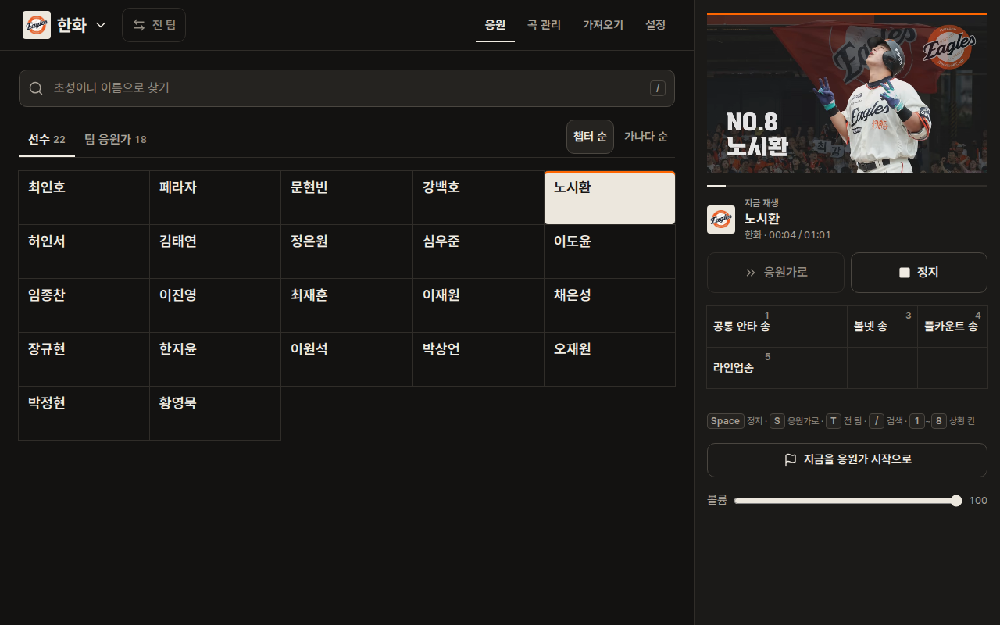

# KBO 응원가 즉시 재생 웹서비스

친구들과 야구 게임(MLB The Show)을 할 때, 타석에 선 선수의 응원가와 풀카운트·볼넷·안타 같은 상황 응원가를 버튼 한 번으로 트는 웹서비스다. 음원 파일은 두지 않고, 팬 채널이 올린 구단별 응원가 모음 영상(YouTube)의 챕터 구간을 재생한다.

2026-2학기 스크립트프로그래밍 과제 / 20241476 김도훈

바로 쓰기: <https://kbocheer.kdhoon.me> (휴대폰과 노트북 모두 이 주소로 열면 재생, 곡 가져오기, YouTube 검색을 모두 쓸 수 있다)

| 휴대폰(360×640) | 노트북(1280×800) |
| --- | --- |
|  |  |

## 주요 기능

- **바로 재생**: 앱을 열면 마지막으로 쓴 팀 화면이 나온다. 선수 이름을 누르면 그 선수 구간만 재생되고 끝에서 멈춘다. 상황 곡은 화면 아래 4×2 상황 칸에 있고, 같은 상황은 팀이 바뀌어도 같은 칸이다.
- **응원가로 건너뛰기**: 등장곡이 나오는 중에 「응원가로」를 누르면 응원가 시작 지점으로 넘어간다. 진행 막대에 그 지점이 눈금으로 보인다. 처음 데이터의 선수곡 146곡에는 지점이 들어 있고, 나머지는 재생 중에 「지금을 응원가 시작으로」를 한 번 눌러 저장한다.
- **팀 전환과 검색**: 「전 팀」으로 바로 전에 본 팀으로 바꾼다. 검색칸에 이름이나 초성(예: ㄴㅅㅎ)을 치면 10개 구단 전체에서 찾고, 다른 팀 곡을 누르면 그 팀 화면으로 바뀌며 재생된다.
- **곡 가져오기**: 곡 관리 화면의 「곡 추가」에서 한다. 모음 영상 URL을 넣으면 YouTube Data API로 설명란의 타임스탬프를 읽어 곡 후보를 만든다. 종류·이름·시각을 확인하고 고친 뒤 저장한다(여러 곡의 종류를 한꺼번에 바꿀 수 있다). 챕터 이름이 「두산 베어스 - 승리를 위하여」처럼 구단으로 시작하는 여러 구단 모음 영상은 지금 팀 곡만 넣거나 구단별로 나눠 넣는다. 챕터가 없는 영상은 곡 하나로, YouTube 검색 결과로도 등록할 수 있다.
- **선수 정보와 사진**: 선수 칸에 이름, 포지션, 오른쪽 아래에 사진이 나온다. 사진은 검색 결과와 재생 줄에도 나온다. 사진이 없으면 구단 기본 아바타가 대신 나온다. 정렬은 주전순(기본, 타석 수 많은 순), 가나다, 자주 튼(이 브라우저에서 튼 횟수, 칸에 「N번」) 순이다.
- **팀 응원가 정렬**: 팀 응원가 탭은 인기순(기본, 구단 안 인기 순위), 가나다, 영상 순으로 정렬한다.
- **가사**: 지금 곡에 가사가 있으면 처음부터 펼쳐 보인다(휴대폰은 재생 줄을 눌러 여는 지금 재생 시트, 넓은 화면은 오른쪽 열의 선수 카드 자리). 「가사 접기」는 지금 곡에만 적용되고 다른 곡은 다시 펼쳐진다. 가사는 곡의 팀·종류·이름으로 찾아 직접 넣은 곡에도 붙는다. 가사 아래에 출처(구단 공식 사이트, 또는 나무위키 문서와 라이선스)를 쓴다.
- **마지막 곡 유지**: 정지하거나 곡이 끝나도 재생 줄에 그 곡이 「멈춤」으로 남고, ▶(다시 재생)로 처음부터 다시 튼다. 새로고침해도 남는다.
- **팀 순서 바꾸기**: 팀 고르기 창의 로고를 끌어(휴대폰은 길게 누른 뒤 끌어) 순서를 바꾼다. 키보드는 Alt+방향키. 「백업·초기화」에서 처음 순서로 되돌린다.
- **최근 튼 곡**: 검색칸을 눌러 두고 아직 아무것도 치지 않으면 최근에 튼 곡 10개가 나온다. 누르면 바로 재생된다. 튼 횟수와 최근 곡은 곡 목록과 따로 이 브라우저에 저장된다.
- **곡 관리**: 곡마다 이름, 종류, 구간, 응원가 시작 지점을 고치거나(미리 듣기 가능) 지운다.
- **데이터 옮기기**: 곡 관리 안 「백업·초기화」에서 곡 목록을 JSON 파일로 내보내고 가져온다(노트북 → 휴대폰). 처음 데이터(10개 구단 507곡)로 되돌릴 수도 있다.
- **재생 조작**: 정지할 때 1초 페이드아웃, 볼륨 조절, 노트북 키보드 단축키(Space 정지, S 응원가로, T 전 팀, / 검색, 1~8 상황 칸).

곡 목록과 설정은 브라우저 LocalStorage에 저장한다. 서버와 로그인은 없다.

## 실행

공개 주소 <https://kbocheer.kdhoon.me>로 열면 설치 없이 쓸 수 있다. 곡 목록과 설정은 기기·브라우저·주소마다 따로 저장되므로, 늘 같은 주소로 열고 다른 기기로 옮길 때는 곡 관리 안 「백업·초기화」의 JSON 내보내기·가져오기를 쓴다.

### 개발 서버

Node.js 20.19 이상 또는 22.12 이상이 필요하다(Vite 8 기준, 개발 환경은 22.21).

```bash
npm install
npm run dev        # http://localhost:5173 (포트 5173 고정, 같은 와이파이에서 LAN 주소로도 열림)
```

곡 가져오기(YouTube Data API)를 쓰려면 프로젝트 폴더에 `.env.local`을 만들고 API 키를 넣는다. 재생, 검색, 곡 관리는 키 없이도 동작한다.

```bash
# .env.local (저장소에 올리지 않는다)
VITE_YOUTUBE_API_KEY=발급받은_API_키
```

- 키는 Google Cloud 콘솔에서 YouTube Data API v3용으로 만들고, HTTP 리퍼러를 `https://kbocheer.kdhoon.me/*`, `http://localhost:5173/*`, `http://127.0.0.1:5173/*`로 제한한다. 앱도 같은 세 출처(`src/lib/env.ts`의 `DATA_API_ORIGINS`)에서만 API를 부른다.
- 선수 사진은 공개 저장소에 없다(구단·KBO 사진이라 저장소와 제출 소스에 넣지 않는다). 개발 서버에서 사진을 보려면 사진 폴더 위치를 `.env.local`에 적는다. 적지 않거나 폴더가 없으면 구단 기본 아바타만 보이고 앱은 그대로 동작한다.

  ```bash
  # .env.local (저장소에 올리지 않는다). 폴더 안은 players/<팀ID>/<선수ID>.jpg 구조
  KBO_MEDIA_DIR=../kbo-cheer-web-media
  ```

  그다음 `npm run media`로 쓰는 자리에 맞춘 WebP를 `media-build/`(저장소에 올리지 않음)에 한 번 만든다. 개발 서버는 이 폴더의 파일을 내준다.

- 개발 서버에 휴대폰이 `http://<노트북 LAN 주소>:5173`으로 접속하면 재생과 곡 관리는 되지만, 키의 리퍼러 제한 때문에 곡 가져오기는 꺼지고 안내 문구가 나온다.

| 명령 | 하는 일 |
| --- | --- |
| `npm run dev` | 개발 서버 |
| `npm run build` | 타입 검사와 배포용 빌드(`dist/`). 선수 사진은 들어가지 않는다 |
| `npm run media` | 사진 원본(`KBO_MEDIA_DIR`, 없으면 `../kbo-cheer-web-media`)으로 썸네일 120×150, 카드 240×300, 누끼 WebP를 `media-build/players/`에, `data/lyrics.json`으로 팀별 가사를 `media-build/lyrics/`에 만든다 |
| `npm run build:deploy` | `media` + `build` + 최적화 WebP만 `dist/players/`로, 팀별 가사를 `dist/lyrics/`로 복사한다. 원본 폴더나 가사 파일이 없으면 안내하고 실패한다 |
| `npm test` | 단위 테스트(Vitest) |
| `npm run test:e2e` | E2E 테스트(Playwright, 실제 YouTube 재생) |
| `npm run lint` | 린트(oxlint) |

### 배포(Cloudflare Workers 정적 자산)

`wrangler.jsonc`가 `dist/`를 정적 자산으로 올리고, 없는 경로는 모두 `index.html`을 돌려준다(SPA). 캐시 정책은 `public/_headers`(해시 붙은 `/assets`와 내용 버전(`?v=`)이 붙은 선수 사진·가사는 1년, 로고·아바타·아이콘은 하루, 앱 주소는 매번 확인)다. Cloudflare 계정 로그인이 필요하다.

```bash
npm run build:deploy          # 사진 최적화 + 빌드 + 최적화 사진을 dist/players/로 복사. .env.local의 키가 빌드 결과에 들어간다
npx wrangler deploy           # 처음에는 npx wrangler login
```

- 사진을 빼고 올리려면(모두 구단 기본 아바타로 보인다) `npm run build`만 돌린다. 사진 폴더 없이 `build:deploy`를 돌리면 빌드 전에 멈추고 폴더 위치를 알려 준다.
- 사진과 가사는 `dist/players/`, `dist/lyrics/`에만 들어가므로 저장소와 `public/`에는 사진과 가사가 없다. `media-build/`도 저장소에 올리지 않는다. 과제 제출용 소스 묶음은 `git archive`처럼 저장소에 있는 파일만 담는 방법으로 만든다. 구단 기본 아바타(`public/avatars/<팀ID>.webp`)는 `assets/avatars-original/`의 원본에서 `node scripts/optimize-avatars.mjs`로 만든다.

- Vite는 `VITE_`로 시작하는 환경 변수를 빌드한 자바스크립트에 그대로 넣는다. 배포된 키는 누구나 볼 수 있으므로 반드시 위의 리퍼러 제한을 걸어 둔다.

## 데이터 출처

- 처음 데이터(10개 구단 507곡): 팬 채널의 구단별 응원가 모음 영상 10편의 설명란 챕터를 앱의 가져오기 기능으로 읽어 만들었다.
- 선수 기록(포지션·타석 수): KBO 공식 기록실(2026 정규시즌).
- 응원가 시작 지점(선수곡 146곡): 136곡은 AI 코딩 에이전트(Claude Code)가 만든 정렬 도구로 정했다. 응원가만 있는 기준 녹음을 모음 영상 선수 구간에서 3초 창의 정규화 상호상관으로 찾고, 창 3개 이상이 50ms 안에서 맞을 때만 정했다. 기준 녹음은 구단 공식 사이트·공식 YouTube 플레이리스트의 녹음(KT·LG·NC·키움·두산·SSG, 110곡)과, 삼성은 공식 녹음이 없어 응원가만 담긴 팬 모음 영상 두 편의 선수 챕터(26곡, 직접 표시한 4곡과의 차이 -0.06~+0.02초)다. 10곡(한화)은 직접 들으며 표시했다.
- 팀 응원가 인기 순위(223곡): AI 코딩 에이전트가 공개 신호로 점수를 냈다. 다른 팀 팬 모음 영상 4편에 뽑혔는지 0.45, YouTube 검색 상위 단일곡 조회수 0.30, 나무위키 대표곡 여부 0.15, 구단 2026 공식 플레이리스트 수록 0.10.
- 가사(616곡): AI 코딩 에이전트가 구단 공식 사이트(KT·LG·NC·키움·삼성, 208곡)와 나무위키 구단별 응원가 문서(408곡, CC BY-NC-SA 2.0 KR)에서 모았다. 구단 공식 가사가 있으면 그것을 쓴다. 곡은 팀·종류·이름으로 찾아, 직접 넣은 곡도 이름이 맞으면 가사가 붙는다. 저장소에는 없고, 화면에 곡마다 출처 링크(나무위키는 라이선스도)를 쓴다.
- 구단 엠블럼과 KBO CI(앱 아이콘): 구단 공식 BI 페이지와 KBO 공식 홈페이지 로고 페이지에서 받았다(출처는 `assets/teams-original/README.md`, `assets/kbo-original/README.md`). 상표권은 각 구단과 KBO에 있고, 비상업 학습용 과제에서 알아보는 표시로만 쓴다.

## 기술

React 19, TypeScript, Vite, React Router, Context + useReducer, LocalStorage, YouTube IFrame Player API, YouTube Data API v3. UI 라이브러리 없이 CSS로 만들었다.

## 문서

- 요구사항 정의서: [docs/requirements.md](docs/requirements.md)
- 설계서: [docs/design.md](docs/design.md)
- 설계 검토: [docs/reviews/](docs/reviews/)
- 단계별 화면 캡처: [docs/screenshots/](docs/screenshots/)
