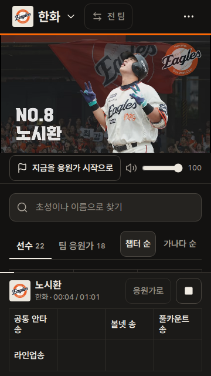

# KBO 응원가 즉시 재생 웹서비스

친구들과 야구 게임(MLB The Show)을 할 때, 타석에 선 선수의 응원가와 풀카운트·볼넷·안타 같은 상황 응원가를 버튼 한 번으로 트는 웹서비스다. 음원 파일은 두지 않고, 팬 채널이 올린 구단별 응원가 모음 영상(YouTube)의 챕터 구간을 재생한다.

2026-2학기 스크립트프로그래밍 과제 / 20241476 김도훈

| 휴대폰(360×640) | 노트북(1280×800) |
| --- | --- |
|  |  |

## 주요 기능

- **바로 재생**: 앱을 열면 마지막으로 쓴 팀 화면이 나온다. 선수 이름을 누르면 그 선수 구간만 재생되고 끝에서 멈춘다. 상황 곡은 화면 아래 4×2 상황 칸에 있고, 같은 상황은 팀이 바뀌어도 같은 칸이다.
- **응원가로 건너뛰기**: 등장곡이 나오는 중에 「응원가로」를 누르면 응원가 시작 지점으로 넘어간다. 지점은 재생 중에 「지금을 응원가 시작으로」를 한 번 눌러 저장한다.
- **팀 전환과 검색**: 「전 팀」으로 바로 전에 본 팀으로 바꾼다. 검색칸에 이름이나 초성(예: ㄴㅅㅎ)을 치면 10개 구단 전체에서 찾고, 다른 팀 곡을 누르면 그 팀 화면으로 바뀌며 재생된다.
- **곡 가져오기**: 모음 영상 URL을 넣으면 YouTube Data API로 설명란의 타임스탬프를 읽어 곡 후보를 만든다. 종류·이름·시각을 확인하고 고친 뒤 저장한다. 챕터가 없는 영상은 곡 하나로, YouTube 검색 결과로도 등록할 수 있다.
- **곡 관리**: 곡마다 이름, 종류, 구간, 응원가 시작 지점을 고치거나(미리 듣기 가능) 지운다.
- **데이터 옮기기**: 곡 목록을 JSON 파일로 내보내고 가져온다(노트북 → 휴대폰). 처음 데이터(10개 구단 507곡)로 되돌릴 수도 있다.
- **재생 조작**: 정지할 때 1초 페이드아웃, 볼륨 조절, 노트북 키보드 단축키(Space 정지, S 응원가로, T 전 팀, / 검색, 1~8 상황 칸).

곡 목록과 설정은 브라우저 LocalStorage에 저장한다. 서버와 로그인은 없다.

## 실행

Node.js 20.19 이상 또는 22.12 이상이 필요하다(Vite 8 기준, 개발 환경은 22.21).

```bash
npm install
npm run dev        # http://localhost:5173 (포트 5173 고정, 같은 와이파이에서 LAN 주소로도 열림)
```

곡 가져오기(YouTube Data API)를 쓰려면 프로젝트 폴더에 `.env.local`을 만들고 API 키를 넣는다. 재생, 검색, 곡 관리는 키 없이도 동작한다.

```bash
# .env.local (저장소에 올리지 않는다)
VITE_YOUTUBE_API_KEY=발급받은_API_키
```

- 키는 Google Cloud 콘솔에서 YouTube Data API v3용으로 만들고, HTTP 리퍼러를 `http://localhost:5173/*`, `http://127.0.0.1:5173/*`로 제한한다.
- 노트북은 항상 `http://localhost:5173`으로 연다. 휴대폰은 `http://<노트북 LAN 주소>:5173`으로 접속한다. 휴대폰에서는 키의 리퍼러 제한 때문에 곡 가져오기가 꺼지므로, 노트북에서 등록한 곡을 JSON 내보내기·가져오기로 옮긴다.
- LocalStorage는 접속 주소마다 따로 저장된다. 주소가 바뀌면 곡 목록도 따로 보인다.

| 명령 | 하는 일 |
| --- | --- |
| `npm run dev` | 개발 서버 |
| `npm run build` | 타입 검사와 배포용 빌드(`dist/`) |
| `npm test` | 단위 테스트(Vitest) |
| `npm run lint` | 린트(oxlint) |

## 기술

React 19, TypeScript, Vite, React Router, Context + useReducer, LocalStorage, YouTube IFrame Player API, YouTube Data API v3. UI 라이브러리 없이 CSS로 만들었다.

## 문서

- 요구사항 정의서: [docs/requirements.md](docs/requirements.md)
- 설계서: [docs/design.md](docs/design.md)
- 설계 검토: [docs/reviews/](docs/reviews/)
- 단계별 화면 캡처: [docs/screenshots/](docs/screenshots/)
